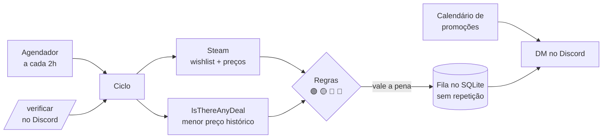

# Steam Deals

Bot que vigia a sua **wishlist da Steam** e avisa por **DM no Discord** quando uma promoção vale a pena de verdade — comparando o preço atual com o **menor preço da história** do jogo.

- 🟢 **Menor preço da história** na Steam, 🟡 **perto dele**, 🔴 longe dele (a "falsa oferta" não gera alerta)
- 🎯 **Preço-alvo por jogo**: avisa quando chegar no valor que você quer, mesmo fora da wishlist
- 🎉 **Grandes promoções** (Winter Sale, Summer Sale…): lembrete na véspera, resumo no início e aviso no último dia
- 💬 **Comandos na DM**: `/verificar` e `/alvo`
- 🔁 **Nunca repete** o mesmo alerta; guarda o histórico em SQLite
- 🪶 Leve: ~35 MB de RAM, **zero dependências** de runtime, roda só com Docker

Preços em reais (região configurável). Menor preço histórico vem do [IsThereAnyDeal](https://isthereanydeal.com).

---

## Como funciona



1. A cada `INTERVALO_HORAS` (ou quando você usa `/verificar`), o bot lê sua wishlist e os preços na Steam.
2. Consulta o menor preço da história no IsThereAnyDeal (se o ITAD cair, usa o último valor salvo).
3. Classifica cada jogo e põe na fila só o que vale a pena e **ainda não foi avisado**.
4. Envia por DM. Se o Discord falhar, o alerta fica na fila e é reenviado no ciclo seguinte.
5. Se o PC ficou desligado, verifica assim que voltar.

> **Mesma oferta = mesmo jogo + mesmo preço + mesma data de fim.** O bot avisa de novo só se o preço cair mais ou se começar outra promoção.

---

## Instalação

Precisa só de **Docker** (e Git para baixar). Nada mais é instalado na máquina.

### 1. Baixar o projeto

```bash
git clone https://github.com/mvieira-hub/steam-deals.git
cd steam-deals
cp .env.example .env
```

### 2. Deixar a wishlist visível

Steam → seu perfil → **Editar perfil → Configurações de privacidade** → **Detalhes de jogos: Público**.
(Pode marcar "Sempre manter meu tempo de jogo total privado".) Copie o número do seu perfil (SteamID64, o que aparece em `steamcommunity.com/profiles/<número>`) para `STEAM_ID` no `.env`.

### 3. Chave do IsThereAnyDeal (grátis)

1. Crie uma conta em [isthereanydeal.com](https://isthereanydeal.com).
2. Em [isthereanydeal.com/apps/my](https://isthereanydeal.com/apps/my/), registre um app (qualquer nome).
3. Copie a **API Key** (não o Client ID nem o Client Secret) para `ITAD_API_KEY` no `.env`.

### 4. Bot do Discord

1. [discord.com/developers/applications](https://discord.com/developers/applications) → **Novo aplicativo**.
2. Menu **Bot** → **Redefinir token** → copie para `DISCORD_BOT_TOKEN` no `.env`.
   Na mesma página: desligue **Bot público** e deixe as **Intents privilegiadas** desligadas.
3. Adicione o bot a um servidor seu (pode ser um criado só para isso — o Discord só deixa o bot mandar DM para quem tem um servidor em comum com ele). Abra, trocando `<ID_DO_APP>` pelo **ID do aplicativo** (página Informações gerais):
   `https://discord.com/oauth2/authorize?client_id=<ID_DO_APP>&scope=bot&permissions=0`
4. Seu ID de usuário: Discord → **Configurações → Avançado → Modo desenvolvedor**; depois botão direito no seu nome → **Copiar ID do usuário** → `DISCORD_USER_ID` no `.env`.

> ⚠️ O token do bot é uma senha. Cole **só** no `.env` (que nunca vai para o git). Se vazar, redefina no Developer Portal.

### 5. Ligar

```bash
docker compose up -d
```

Pronto. O bot volta sozinho quando o Docker inicia — mas só roda com o PC ligado. Para deixá-lo 24/7 de graça numa VM da Oracle Cloud, siga o [roteiro do servidor](docs/servidor-24-7.md).

Para ver o que ele está fazendo:

```bash
docker compose logs -f bot
```

---

## Uso no dia a dia

### Comandos na DM do bot

| Comando | O que faz |
|---|---|
| `/verificar` | Verifica agora, sem esperar o intervalo, e responde com o resumo |
| `/alvo definir jogo valor` | Avisa quando o jogo chegar em `valor` reais ou menos |
| `/alvo remover jogo` | Remove o preço-alvo |
| `/alvo listar` | Mostra seus preços-alvo |

Em `jogo` vale o **link da loja**, o **número do app** ou **parte do nome** de um jogo da sua wishlist. Só o dono (`DISCORD_USER_ID`) consegue usar os comandos.
Se os comandos não aparecerem ao digitar `/`, recarregue o Discord (Ctrl+R).

### Comandos do Docker

| Comando | Para quê |
|---|---|
| `docker compose up -d` | Liga o bot |
| `docker compose down` | Desliga |
| `docker compose restart` | Reinicia (necessário depois de mudar o `.env`) |
| `docker compose logs -f bot` | Acompanha o log |
| `docker compose exec bot node src/index.ts --uma-vez` | Roda uma verificação agora (o mesmo que `/verificar`) |
| `docker compose run --rm bot node src/spike.ts` | Tabela de diagnóstico: o que o bot veria agora, sem gravar nem enviar |

---

## Configuração

Tudo no `.env`. Linha vazia = valor padrão. Valor inválido faz o bot parar na hora com uma mensagem dizendo o que corrigir.

| Variável | Padrão | O que é |
|---|---|---|
| `STEAM_ID` | — | Seu SteamID64 |
| `COUNTRY` | `BR` | Região dos preços |
| `ITAD_API_KEY` | — | Chave do IsThereAnyDeal (sem ela, não há selo 🟢/🟡) |
| `DISCORD_BOT_TOKEN` | — | Token do bot |
| `DISCORD_USER_ID` | — | Quem recebe as DMs e pode usar os comandos |
| `DISCORD_COMANDOS` | `1` | `0` desliga `/verificar` e `/alvo` (o bot só envia) |
| `INTERVALO_HORAS` | `2` | De quanto em quanto tempo verificar (1 a 24) |
| `RESUMO_ACIMA_DE` | `5` | Acima disso, as ofertas chegam numa lista compacta em vez de cards |
| `MARGEM_PERTO_PCT` | `10` | Até quantos % acima do menor preço ainda é 🟡 |
| `DESCONTO_MIN_PCT` | `0` | Desconto mínimo para alertar (0 = o selo decide sozinho) |
| `REVIEW_MIN_PCT` | `0` | Nota mínima (% positivas); 0 = sem filtro. Jogo sem análises sempre passa |
| `REFERENCIA` | `steam` | Menor preço de referência: `steam` ou `qualquer` loja (mais rigoroso) |
| `SEM_HISTORICO_MIN_PCT` | `50` | Jogo sem histórico no ITAD só alerta a partir deste desconto |
| `CALENDARIO_CAMINHO` | `config/eventos-steam.json` | Calendário de promoções |
| `ALVOS_CAMINHO` | `config/precos-alvo.json` | Preços-alvo em arquivo |
| `BANCO_CAMINHO` | `data/steam-deals.db` | Banco SQLite |

### Os selos

| Selo | Quando | Alerta? |
|---|---|---|
| 🎯 | Preço igual ou abaixo do seu alvo | Sempre (ignora desconto mínimo e nota) |
| 🟢 | Em promoção e no menor preço da história (ou abaixo) | Sim |
| 🟡 | Até `MARGEM_PERTO_PCT` acima do menor | Sim |
| ⚪ | Em promoção, sem histórico no ITAD | Só com desconto ≥ `SEM_HISTORICO_MIN_PCT` |
| 🔴 | Em promoção, mas longe do menor ("falsa oferta") | Não |
| · | Sem desconto | Não |

### Calendário de promoções

[`config/eventos-steam.json`](config/eventos-steam.json) traz as datas oficiais da [página da Valve](https://partner.steamgames.com/doc/marketing/upcoming_events). As promoções começam e terminam às 10h do horário do Pacífico. **Atualize duas vezes por ano** — o bot avisa no log quando não houver evento futuro.

Para cada evento: ⏰ lembrete na véspera, 🎉 aviso no início (com as ofertas dentro dele) e ⌛ último dia (só se ainda houver algo que valha a pena).

### Preços-alvo em arquivo

Além do `/alvo`, dá para listar alvos em [`config/precos-alvo.json`](config/precos-alvo.json):

```json
"alvos": [
  { "jogo": "https://store.steampowered.com/app/1174180/Red_Dead_Redemption_2/", "nome": "Red Dead Redemption 2", "ate": 50.00 }
]
```

O arquivo é relido a cada verificação (não precisa reiniciar). Se o mesmo jogo estiver no arquivo e no `/alvo`, vale o do Discord.

---

## Problemas comuns

| Sintoma | Causa e solução |
|---|---|
| Log: *"A Steam negou acesso à wishlist"* | "Detalhes de jogos" está privado (passo 2) |
| Log: *"O Discord recusou a DM"* | O bot não está num servidor em comum com você, ou as DMs de membros desse servidor estão desligadas |
| Log: *"Gateway do Discord recusou a conexão (código 4004)"* | Token inválido ou redefinido: atualize `DISCORD_BOT_TOKEN` e `docker compose restart` |
| Comandos não aparecem | Recarregue o Discord (Ctrl+R); confira no log *"Comandos do Discord ativos"* |
| O bot não voltou depois de ligar o PC | Ele foi parado manualmente (botão Stop no Docker Desktop ou `docker compose stop`). Rode `docker compose up -d` |
| Alertas chegam atrasados | O bot só roda com o PC ligado e acordado. Desligue a suspensão do Windows na tomada ou [rode num servidor 24/7](docs/servidor-24-7.md) |

---

## Desenvolvimento

Tudo roda no container `node:24-alpine`; o Node 24 executa TypeScript direto, sem etapa de build.

```bash
docker compose run --rm bot npm test        # testes (node:test)
docker compose run --rm bot sh -c "npm install && npx tsc"   # checagem de tipos
```

```
src/
├─ index.ts              o bot: agendador, comandos, encerramento
├─ config.ts             .env validado
├─ domain/               regras puras: selos, eventos, mensagens (sem rede, sem banco)
├─ providers/            Steam e IsThereAnyDeal
├─ jobs/                 o ciclo de verificação
├─ db/                   SQLite nativo (node:sqlite): migrações e repositório
├─ discord/              REST, gateway (WebSocket) e comandos
├─ notifiers/discord/    DM e visual dos alertas
├─ eventos/ · alvos/     leitura dos arquivos de config/
└─ spike.ts              tabela de diagnóstico
```

- **Migração de banco é sempre um item novo** no fim de [`src/db/migracoes.ts`](src/db/migracoes.ts) — nunca editar uma que já rodou.
- **Canal novo** (Telegram, WhatsApp…): implementar a interface `Notifier` de [`src/domain/alerta.ts`](src/domain/alerta.ts).
- As tabelas já guardam `steam_id` e `destino`, pensando em atender mais de uma pessoa no futuro.
