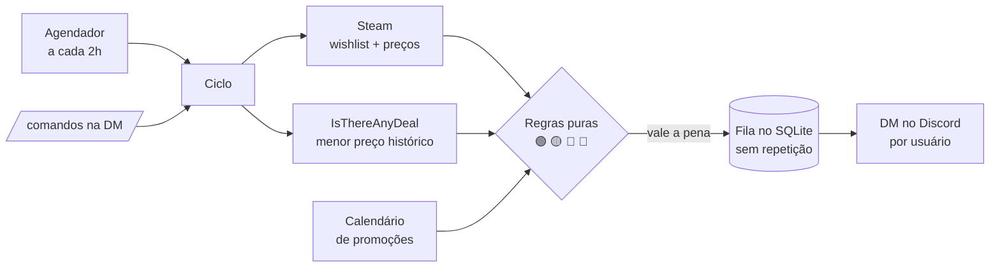

# Steam Deals

Bot que vigia a **wishlist da Steam** e avisa por **DM no Discord** quando uma promoção vale a pena de verdade — comparando o preço atual com o **menor preço da história** do jogo, não só com o preço cheio.


-003B57?logo=sqlite&logoColor=white)


[](https://github.com/mvieira-hub/steam-deals/actions/workflows/ci.yml)

> **Por que o "menor preço histórico" importa:** uma promoção de −75% pode ainda estar bem acima do que o jogo já custou. O bot cruza o preço atual com o histórico (via [IsThereAnyDeal](https://isthereanydeal.com)) e separa a oferta de verdade da "falsa oferta".

```
🟢 Red Dead Redemption 2 — R$ 74,97  (-75%)   menor da história: R$ 74,97   ← avisa
🔴 Starfield            — R$ 149,94 (-40%)   menor da história: R$ 99,00   ← ignora
```

---

## O que ele faz

- 🟢/🟡/🔴 **Classifica cada oferta** pelo menor preço histórico: no menor (🟢), perto dele (🟡) ou longe (🔴, não alerta).
- 🎯 **Preço-alvo por jogo** ("avise se Lies of P ficar abaixo de R$ 100"), mesmo fora da wishlist.
- 🎉 **Grandes promoções** (Summer, Winter Sale…): lembrete na véspera, resumo no início e aviso no último dia.
- 💬 **Comandos na DM** do Discord: `/cadastrar`, `/verificar`, `/alvo`, `/descadastrar`.
- 👥 **Multiusuário**: cada pessoa cadastra o próprio perfil e recebe os próprios alertas; os preços são consultados **uma vez só** para todo mundo.
- 🔁 **Nunca repete** um alerta e **reenvia** o que falhou (fila no SQLite).
- 🪶 **Leve**: ~35 MB de RAM, **zero dependências de runtime**, roda só com Docker.

---

## Destaques técnicos

Este projeto foi feito como um exercício de engenharia enxuta — fazer um serviço resiliente **sem arrastar um ecossistema de dependências** atrás:

- **Zero dependências de runtime.** Nada de `node_modules` em produção. Usa só o que vem no Node 24: `fetch`, `WebSocket`, `node:sqlite`, `node:test`.
- **TypeScript sem etapa de build.** O Node 24 executa `.ts` direto (type stripping); o `tsc` serve só para checagem de tipos. Menos ferramenta, menos atrito.
- **Arquitetura de portas e adaptadores.** O `domain/` é puro (regras de selo, eventos, mensagens) — sem rede e sem banco, 100% testável. Steam, ITAD, Discord e SQLite são adaptadores plugáveis. Um canal novo (Telegram, WhatsApp) é só implementar a interface `Notifier`.
- **Cliente de gateway do Discord próprio**, sobre o `WebSocket` nativo: heartbeat, detecção de conexão zumbi e reconexão com retomada de sessão — sem `discord.js`.
- **Resiliência de verdade:** fila *outbox* com deduplicação (não repete alerta), reenvio do que falhou, *fallback* do menor preço em cache quando o ITAD cai, e o bot nunca para por falha de um usuário (wishlist privada de um não afeta os outros).
- **Agendador próprio** que conta o intervalo a partir da última execução bem-sucedida — recupera na hora quando a máquina ficou desligada.
- **Banco versionado por migrações** (SQLite nativo), com histórico de preços, cache do ITAD e a fila de notificações.
- **Testado**: mais de 80 testes com o runner nativo (`node:test`), rodando no CI a cada push.

---

## Arquitetura



```
src/
├─ index.ts              composição: liga tudo, agendador, comandos, encerramento limpo
├─ config.ts             .env validado (falha cedo, com mensagem clara)
├─ domain/               núcleo puro — sem rede, sem banco, 100% testável
│  ├─ deal-evaluator.ts  a regra: que selo cada oferta recebe e se vale alertar
│  ├─ evento.ts          fases de uma promoção sazonal (véspera / início / último dia)
│  ├─ mensagens.ts       o texto e o formato de cada aviso
│  └─ alerta.ts          tipos + a interface Notifier (porta de saída)
├─ providers/            adaptadores de entrada
│  ├─ steam/             wishlist, preços e resolução de perfil (sem API key)
│  └─ itad/              menor preço histórico
├─ jobs/                 o ciclo que orquestra tudo, por usuário
├─ db/                   SQLite nativo: migrações e repositório (todo o SQL isolado aqui)
├─ discord/              REST, gateway (WebSocket) e comandos de barra
├─ notifiers/discord/    adaptador de saída: DM e o visual dos alertas (embeds)
├─ eventos/ · alvos/     leitura dos arquivos de config/
├─ lib/                  utilidades: log, formatação, monitor de saúde
├─ backup.ts             cópia consistente do banco (VACUUM INTO)
└─ spike.ts              diagnóstico: mostra em tabela o que o bot veria agora
```

Mais detalhes e o porquê de cada escolha em **[docs/arquitetura.md](docs/arquitetura.md)**.

---

## Rodando localmente

Precisa só de **Docker** (e Git para baixar). Nenhum runtime é instalado na máquina.

```bash
git clone https://github.com/mvieira-hub/steam-deals.git
cd steam-deals
cp .env.example .env     # preencha as chaves (passo a passo abaixo)
docker compose up -d
docker compose logs -f bot
```

Para ver o que o bot acharia **agora**, sem gravar nem enviar nada:

```bash
docker compose run --rm bot node src/spike.ts
```

### Chaves necessárias (no `.env`)

1. **SteamID64** (`STEAM_ID`): seu perfil com **"Detalhes de jogos" público** (Steam → Editar perfil → Privacidade).
2. **IsThereAnyDeal** (`ITAD_API_KEY`): chave gratuita em [isthereanydeal.com/apps](https://isthereanydeal.com/apps/my/) (a *API Key*, não o Client ID/Secret).
3. **Bot do Discord** (`DISCORD_BOT_TOKEN` + `DISCORD_USER_ID`): crie um app no [Developer Portal](https://discord.com/developers/applications), pegue o token em **Bot**, e adicione o bot a um servidor seu (o Discord só deixa o bot mandar DM para quem compartilha um servidor com ele).

> 🔒 O `DISCORD_BOT_TOKEN` e a `ITAD_API_KEY` são segredos. Ficam **só no `.env`**, que nunca entra no git.

### 24/7 de graça

Com o PC, o bot só roda enquanto ele está ligado. O roteiro **[docs/servidor-24-7.md](docs/servidor-24-7.md)** mostra como colocá-lo numa VM gratuita da Oracle Cloud (always free), com deploy por `git pull`, backup diário e reinício automático.

---

## Usando

### Comandos na DM do bot

| Comando | O que faz |
|---|---|
| `/cadastrar perfil` | Começa a receber alertas da sua wishlist (link ou número do perfil Steam) |
| `/verificar` | Verifica agora e responde com o resumo |
| `/alvo definir jogo valor` | Avisa quando o jogo chegar em `valor` reais ou menos |
| `/alvo remover jogo` · `/alvo listar` | Gerencia seus preços-alvo |
| `/descadastrar` | Para os alertas e apaga seus dados |
| `/usuarios` | (dono) lista quem está cadastrado |

Em `jogo` vale o **link da loja**, o **número do app** ou **parte do nome** de um jogo conhecido.

### Os selos

| Selo | Quando | Alerta? |
|---|---|---|
| 🎯 | Preço igual ou abaixo do seu alvo | Sempre (ignora os filtros) |
| 🟢 | Em promoção e no menor preço da história (ou abaixo) | Sim |
| 🟡 | Até `MARGEM_PERTO_PCT` % acima do menor | Sim |
| ⚪ | Em promoção, sem histórico no ITAD | Só com desconto ≥ `SEM_HISTORICO_MIN_PCT` |
| 🔴 | Em promoção, mas longe do menor ("falsa oferta") | Não |
| · | Sem desconto | Não |

---

## Configuração

Tudo no `.env`. Linha vazia = valor padrão. Valor inválido derruba o bot na partida com uma mensagem dizendo o que corrigir.

| Variável | Padrão | O que é |
|---|---|---|
| `STEAM_ID` | — | Seu SteamID64 (o dono entra como primeiro usuário) |
| `COUNTRY` | `BR` | Região dos preços |
| `ITAD_API_KEY` | — | Chave do IsThereAnyDeal (sem ela, não há selo 🟢/🟡) |
| `DISCORD_BOT_TOKEN` | — | Token do bot |
| `DISCORD_USER_ID` | — | O dono: recebe DMs e tem o `/usuarios` |
| `DISCORD_COMANDOS` | `1` | `0` desliga os comandos (o bot só envia) |
| `MAX_USUARIOS` | `30` | Máximo de pessoas cadastradas pelo `/cadastrar` |
| `INTERVALO_HORAS` | `2` | De quanto em quanto tempo verificar (1 a 24) |
| `RESUMO_ACIMA_DE` | `5` | Acima disso, as ofertas chegam numa lista compacta |
| `MARGEM_PERTO_PCT` | `10` | Até quantos % acima do menor ainda é 🟡 |
| `DESCONTO_MIN_PCT` | `0` | Desconto mínimo para alertar (0 = o selo decide) |
| `REVIEW_MIN_PCT` | `0` | Nota mínima (% positivas); 0 = sem filtro |
| `REFERENCIA` | `steam` | Menor preço de referência: `steam` ou `qualquer` loja |
| `SEM_HISTORICO_MIN_PCT` | `50` | Sem histórico no ITAD, só alerta a partir deste desconto |
| `MONITOR_URL` | — | URL de "estou vivo" (ex.: Healthchecks.io); vazio = desligado |
| `CALENDARIO_CAMINHO` | `config/eventos-steam.json` | Calendário de promoções |
| `ALVOS_CAMINHO` | `config/precos-alvo.json` | Preços-alvo em arquivo |
| `BANCO_CAMINHO` | `data/steam-deals.db` | Banco SQLite |

O **calendário de promoções** ([`config/eventos-steam.json`](config/eventos-steam.json)) traz as datas oficiais da [Valve](https://partner.steamgames.com/doc/marketing/upcoming_events) e deve ser atualizado a cada semestre — o bot avisa no log quando acabam os eventos futuros.

---

## Desenvolvimento

O Node 24 roda o TypeScript direto, sem build.

```bash
docker compose run --rm bot npm test                       # testes (node:test)
docker compose run --rm bot sh -c "npm install && npx tsc" # checagem de tipos
```

- **Núcleo puro primeiro:** a lógica de negócio vive em `domain/`, sem rede nem banco — por isso dá para testá-la inteira sem mocks de infraestrutura.
- **Migração de banco** é sempre um item novo no fim de [`src/db/migracoes.ts`](src/db/migracoes.ts) — nunca editar uma que já rodou.
- **Canal de notificação novo**: implemente a interface `Notifier` de [`src/domain/alerta.ts`](src/domain/alerta.ts).
- O CI ([`.github/workflows/ci.yml`](.github/workflows/ci.yml)) roda tipos + testes a cada push.

---

## Ideias para o futuro

- Canal no **Telegram** / WhatsApp (a interface `Notifier` já está pronta para isso).
- Lista de desejos da **Nintendo eShop** (preços em reais; histórico via DekuDeals).
- Regras por usuário (margem e filtros individuais).
- Aviso no próprio Discord se o bot ficar muito tempo sem rodar.

---

## Stack

TypeScript · Node.js 24 (sem build, zero dependências de runtime) · SQLite (`node:sqlite`) · WebSocket e `fetch` nativos · Docker · GitHub Actions · APIs da Steam e do IsThereAnyDeal.

## Licença

[MIT](LICENSE).
